# 5G RAN Digital Twin for Channel-Aware Resource Allocation and Network What-If Analysis

*5G and Beyond — Semester I project, 2026*

---

## Abstract

We build a site-specific digital twin of a 3-site, 9-sector NR band n78 (3.5 GHz, 100 MHz) network
in a dense European city block using NVIDIA Sionna RT, a GPU/CPU ray tracer from NVIDIA's
Aerial/Sionna ecosystem. The twin produces per-link, per-PRB channel responses for 850 UE
locations. A slot-level downlink simulator turns these into 5G KPIs (SINR, CQI, throughput,
interference, PRB utilisation, fairness).

Using twin channel knowledge for cell association, frequency-selective proportional-fair
scheduling and inter-cell PRB coordination raises mean UE throughput by **45 %** over a
nearest-site / fixed-PRB baseline. It also lifts cell-edge (5th-percentile) throughput from
**0 to 5.7 Mbps** and cuts outage from **26 % to 1.6 %**. The gain comes mostly from the city
geometry: for **31 %** of locations the nearest site is not the best server.

We then test the twin against a deliberately different "physical network": deeper ray tracing,
different building materials, shadowing, small-scale fading and 5 m UE position error. A twin
that is *not* synchronised with the network loses its advantage. A twin synchronised with
standard UE measurement reports keeps most of it (+23 % mean throughput, outage 23 % → 2 %).
It also predicts the effect of what-if changes (UE density ×2 / ×3.3, an event hotspot,
40 MHz carrier, switching a site off) to within **3.9 percentage points** on average, versus
**20 points** for a 3GPP TR 38.901 statistical model.

---

## 1. Background: what a network digital twin is

3GPP TR 28.915 (Rel-19) defines a network digital twin (NDT) as a virtual replica of a mobile
network, or part of it, that captures its attributes, behaviour and interactions. Its main
elements are:

- **Data** that keeps the twin synchronised with the managed network.
- **Models**, either *emulation* (duplicating real network functions) or *simulation*
  (mathematical models of behaviour).
- **What-if analysis**: a consumer configures a scenario, runs it on the replica and receives
  a report on its impact, *without changing the live network*.

The TR studies use cases such as RAN energy-saving policy verification (§5.1), configuration
verification (§5.9), generating ML training data (§5.6) and topology/traffic visualisation (§5.8).

This project implements a small but complete NDT of the simulation type:

| NDT element (TR 28.915) | This project |
|---|---|
| Physical network | High-fidelity stand-in (§3.4), since no live network was available |
| Twin model | 3D city scene + RUs + UEs, ray-traced with Sionna RT (`dt/twin.py`) |
| Data / synchronisation | UE SS-RSRP measurement reports used to calibrate the twin (§6.3) |
| Analytics & decisions | KPI engine + 5 allocation strategies (`dt/kpi.py`, `dt/alloc.py`) |
| What-if | 6 scenarios predicted before "applying" them (§8) |
| Visualisation | Coverage, best-server, association and PRB-grid views (Figs 1–3, 6, 9) |

## 2. Choice of framework

The brief suggests NVIDIA Aerial Omniverse Digital Twin (AODT). AODT needs an NVIDIA GPU of
compute capability SM 8.0/8.6/8.9/9.0 (A100, RTX 30/40-series, L40/L40S, H100), an NGC API key,
and membership in NVIDIA's 6G Developer Program. Our compute environment had **no GPU** (2 CPU
cores, 8 GB RAM), so AODT could not be run.

We therefore used **Sionna RT 2.2**, NVIDIA's open-source ray tracer. Published comparisons
report functionally identical EM propagation effects to AODT, with AODT faster at large scale and
adding mobility and RAN features. Sionna RT runs on CPU through Mitsuba's LLVM backend and
switches to CUDA automatically when a GPU is present.

The code is structured so the radio layer can be swapped: everything downstream of
`DigitalTwin.trace()` consumes a `ChannelSet`, i.e. per-PRB channel power `H2[UE, RU, PRB]`
plus geometry. AODT's CFR/raypath output can be loaded into the same structure (README).

## 3. Scenario and twin construction (Task 1)

### 3.1 Scenario

| Parameter | Value |
|---|---|
| Scene | Sionna RT `munich` — OpenStreetMap buildings with ITU-R P.2040 materials |
| Area of interest | 600 m × 600 m |
| Carrier | 3.5 GHz (n78), 100 MHz, 30 kHz SCS → 273 PRBs, 0.5 ms slot |
| Sites | 3 gNB sites × 3 sectors (0°/120°/240°) = 9 RUs |
| RU | 25 m height, 8° downtilt, 46 dBm (−0.2 dBm per RE), TR 38.901 sector element (8 dBi, 65° HPBW) |
| UE | 1.5 m, isotropic, NF 9 dB; noise −109.4 dBm per PRB |
| UE locations | 700 uniform outdoor points + 150 in a 45 m event hotspot (Fig. 1) |
| Traffic | Full-buffer downlink |

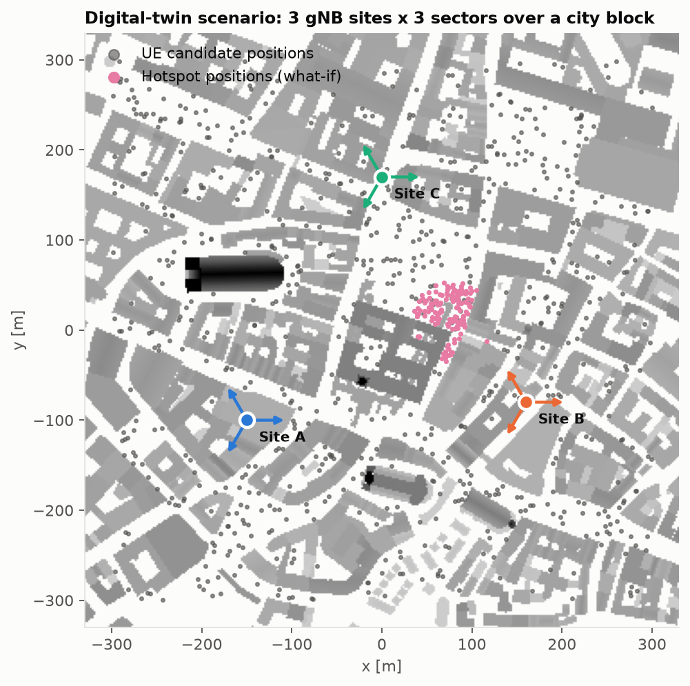

*Fig. 1 — Scenario: building heights (grey), the three sites with sector boresights, and the
candidate UE positions. UE positions are sampled only at street level, at least 1.5 m from
any wall.*

### 3.2 Configuration parameters the twin exposes

All parameters live in `config/scenario.yaml`:

- **Radio:** carrier frequency, bandwidth, SCS/numerology, number of PRBs, noise figure, overhead,
  BLER target.
- **RAN:** site positions, sector azimuths, RU height, downtilt, Tx power, antenna pattern,
  beamforming gain.
- **Environment:** the scene (any Mitsuba XML, e.g. exported from OpenStreetMap with Blender
  or Geo2SigMap), and each material's permittivity, conductivity and scattering coefficient.
- **Propagation solver:** max interactions per path, rays per transmitter, and which
  interactions are enabled (LOS, specular reflection, diffuse scattering, refraction,
  wedge/edge diffraction).
- **UEs:** positions, height, antenna, mobility.

The equivalent AODT controls are documented in §9.

### 3.3 Two ray-tracing fidelity profiles

| | Twin (fast) | Physical (stand-in) |
|---|---|---|
| Max interactions | 3 | 4 |
| Rays per RU | 3 × 10⁵ | 10⁶ |
| Diffraction (wedge + edge) | yes | yes |
| Building materials | ITU defaults | permittivity ×1.4, conductivity ×2 |
| Shadowing (unmodelled objects) | — | 4 dB log-normal per link |
| Small-scale fading | — | frequency-correlated Rayleigh on NLOS links |
| UE positions known to the operator | true / ±5 m GPS error | true |
| Runtime, 850 UEs × 9 RUs (2-core CPU) | 196 s | 730 s |

### 3.4 Why a "physical network" stand-in

The brief asks to evaluate allocations "before applying them to the network". With no live
network, we follow standard practice in the NDT literature: a higher-fidelity model with effects
the twin does not know about plays the role of the real network. Every decision in Task 7 is made
on the twin and *scored* on the stand-in. This makes the sim-to-real gap measurable rather than
assumed away.

### 3.5 Links the ray tracer cannot resolve

A depth-limited ray tracer finds no path for 45 % of RU–UE links in this dense scene. These are
mostly multi-diffraction paths over roofs, which matter as interference. We fill them with
TR 38.901 UMa-NLOS path loss plus the sector pattern, shifted by **−14.8 dB**. That offset is
the median residual between the twin's resolved NLOS links and the same model, so filled links
are as strong as a typical resolved NLOS link, never stronger. Fig. 4 shows the filled links in grey.

## 4. Site-specific channel information and RAN measurements (Task 2)

For every UE–RU pair the twin exports:
- the channel frequency response at all 273 PRB centres,
- wideband path gain, SS-RSRP, LOS flag and whether a ray path was found,
- RMS delay spread and number of paths.

From these we derive per-UE RAN measurements: best-server RSRP, RSRQ (full load), geometry
SINR, CQI, and the margin to the second-best cell.

Deliverables:
- `results/tables/t2_channel_database.csv` (6,300 links)
- `results/tables/t2_ue_measurements.csv`
- `data/*.npz` (full per-PRB arrays)

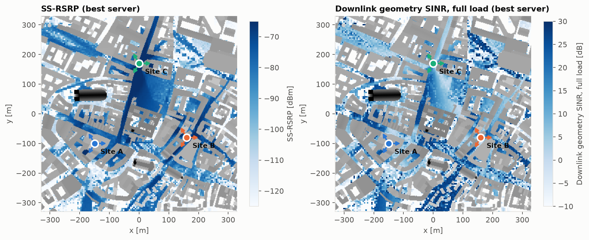

*Fig. 2 — Best-server SS-RSRP and full-load geometry SINR. Coverage follows the street canyons.
The open square north of the centre is lit by site C, while courtyards a few metres away are
20–40 dB weaker.*

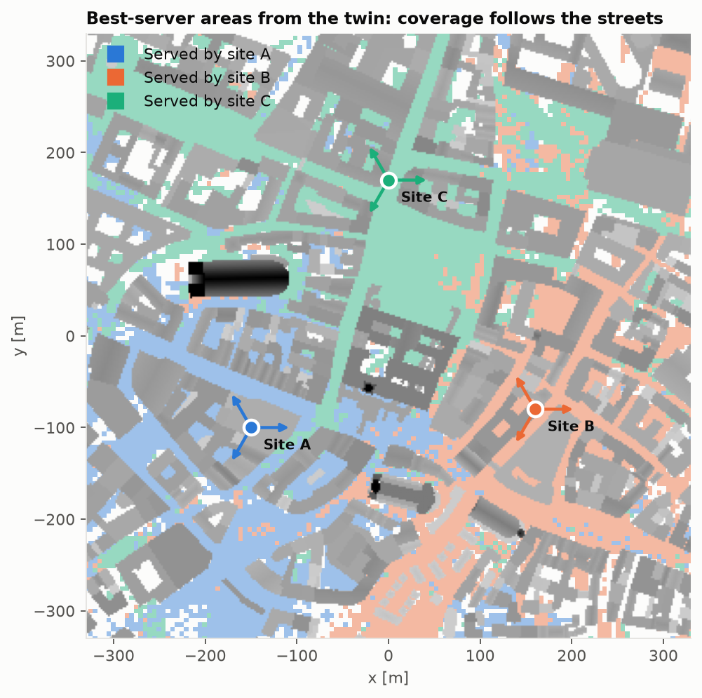

*Fig. 3 — Best-server areas. They are not the hexagon-like regions a distance model predicts:
site C serves a long corridor reaching the area of site A.*

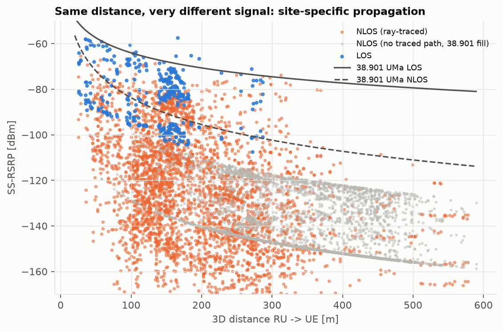

*Fig. 4 — RSRP vs distance for all links. At 150–200 m the 5th–95th-percentile spread is
**77 dB**. LOS links follow the 38.901 LOS curve closely; NLOS links scatter far below the
38.901 NLOS mean. Distance alone is a poor predictor here.*

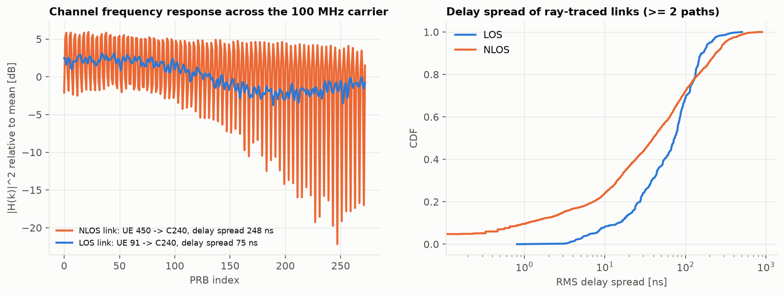

*Fig. 5 — Left: a typical LOS link is almost flat over 100 MHz, while an NLOS link with 248 ns
delay spread fades by up to 20 dB across PRBs. Right: delay-spread CDFs. This frequency
selectivity is what the PF scheduler exploits.*

| Measurement (700 uniform UEs) | Value |
|---|---|
| Links with geometric LOS | 4.9 % |
| UEs whose best server is in LOS | 14.6 % |
| UEs whose best server is **not** at the nearest site | **31.3 %** |
| Median best-server RSRP / SINR / CQI | −104 dBm / 7.0 dB / 4 |
| Median ray-traced paths per link | 11 |
| Median delay spread, LOS / NLOS (links with ≥2 paths) | 74 ns / 40 ns |

## 5. Allocation strategies (Tasks 3 and 4)

### 5.1 Downlink model

Each RU spreads its power equally over the PRBs it uses. For UE *u* served by RU *s* on PRB *k*:

  SINR(u,k) = P_prb · |H_s,u(k)|² / ( Σ_{j≠s, j active on k} P_prb · |H_j,u(k)|² + N_prb )

Link abstraction works per transport block, using all PRBs the UE got in that slot:
- **Effective SINR** (mutual-information averaging): SINR_eff = 2^{mean_k log₂(1+SINR_k)} − 1.
- **CQI** from SINR_eff, using the TS 38.214 Table 5.2.2.1-3 (256QAM) efficiencies. Each CQI
  threshold is placed 3 dB from the Shannon bound.
- **Bits per slot** = efficiency × PRBs × 12 × 14 × (1 − 0.14 overhead) × (1 − 0.1 BLER).
  At 256QAM this gives 584 Mbps for one layer over 100 MHz, matching TS 38.306.

Link adaptation always uses the *real* channel (CQI feedback). Association and scheduling use
whatever the operator *believes*: geometry for the baselines, the twin for T1–T3.

### 5.2 Strategies

| ID | Association | PRB allocation | Twin knowledge used |
|---|---|---|---|
| **B1** | Nearest site; sector by bearing | Fixed equal contiguous blocks | none (geometry only) |
| **B2** | Nearest site; sector by bearing | Random every slot | none |
| **T1** | Max RSRP from twin | Fixed equal blocks | wideband gain |
| **T2** | Twin load-aware: start from max-RSRP, move UEs (within 8 dB) when it raises Σ log(predicted rate) | Frequency-selective proportional fair (PF), per-PRB | per-PRB SINR |
| **T3** | as T2 | PF + **twin-predicted coordinated muting**: on each PRB, greedily silence the cell whose silence most increases the PF-weighted predicted sum rate | per-PRB channels to *all* RUs |

T3 is a light form of coordinated scheduling (CoMP-CS). It can only be done with a twin, because
it needs each UE's channel from *every* neighbouring RU on *every* PRB.

## 6. Results: baseline vs twin-assisted (Task 6)

30 Monte Carlo drops × 30 UEs × 40 slots, twin channels as ground truth.

| KPI | B1 | B2 | T1 | T2 | **T3** |
|---|---|---|---|---|---|
| Mean UE throughput [Mbps] | 36.3 | 36.1 | 46.6 | 47.3 | **52.5** |
| Cell-edge (5th pct) throughput [Mbps] | 0.0 | 0.0 | 3.4 | 4.8 | **5.7** |
| Median UE throughput [Mbps] | 15.3 | 15.9 | 27.2 | 32.8 | **41.9** |
| Mean effective SINR [dB] | 1.1 | 1.2 | 8.6 | 10.1 | **13.6** |
| Mean interference [dBm/PRB] | −96.1 | −96.0 | −98.6 | −99.1 | **−102.9** |
| Mean CQI | 4.5 | 4.5 | 5.8 | 6.5 | **8.2** |
| PRB utilisation [%] | 100 | 100 | 100 | 100 | 85.4 |
| Jain fairness | 0.34 | 0.34 | 0.41 | 0.49 | **0.55** |
| Outage (< 1 Mbps) [%] | 26.1 | 25.9 | 0.9 | 2.0 | **1.6** |
| Spectral efficiency per loaded cell [bit/s/Hz] | 1.31 | 1.31 | 1.68 | 1.62 | **1.80** |

95 % confidence intervals are in `t6_kpi_ci95.csv`. Mean-throughput CIs are ±3 Mbps, so all
T-vs-B differences are significant.

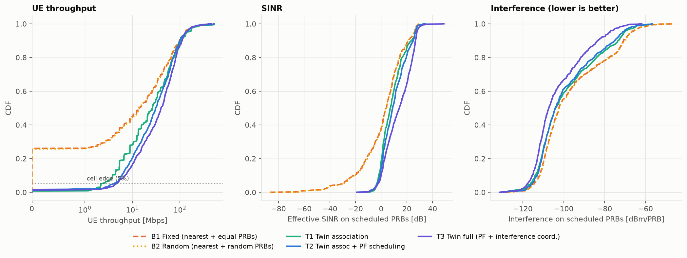

*Fig. 7 — CDFs of UE throughput, effective SINR and interference.*

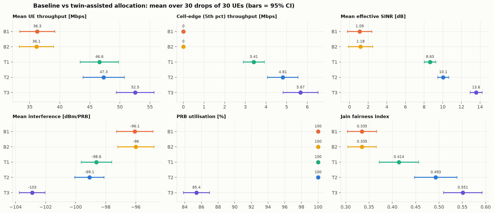

*Fig. 8 — Mean KPIs with 95 % confidence intervals.*

**What the numbers say**

1. **Association is the largest single gain (B1 → T1).** About one UE in four ends up with no
   usable link to its nearest site because buildings block it. Those UEs get 0 Mbps under B1, so B1's
   cell-edge throughput is zero. Using the twin's RSRP removes almost all outage (26 % → 0.9 %).
   Random PRB allocation (B2) changes nothing, because the problem is *who* serves, not *which* PRBs.
2. **Frequency-selective PF (T1 → T2)** raises the median by 20 % and fairness from 0.41 to 0.49
   by giving each UE the PRBs where its own channel peaks (Fig. 5).
3. **Twin-predicted interference coordination (T2 → T3)** mutes about 15 % of PRB-cell pairs
   (Fig. 9), lowers mean interference by 3.8 dB and raises SINR by 3.5 dB. Total throughput still
   *rises* by 11 %, so the twin finds PRBs where silence pays.

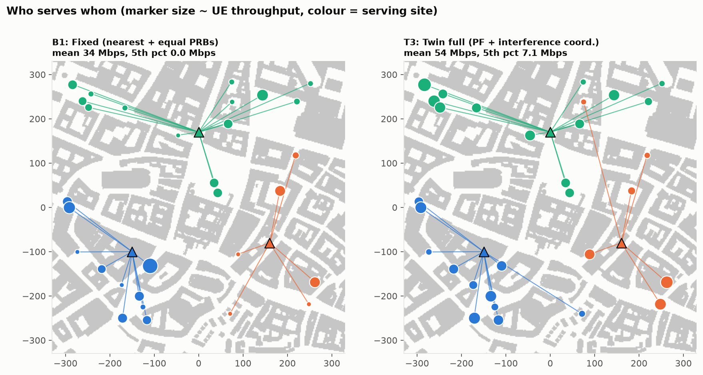

*Fig. 6 — One drop: B1 (left) vs T3 (right). Twin association reaches across streets (e.g. site
B serving a UE about 330 m to the north along an open corridor). Marker size shows throughput.*

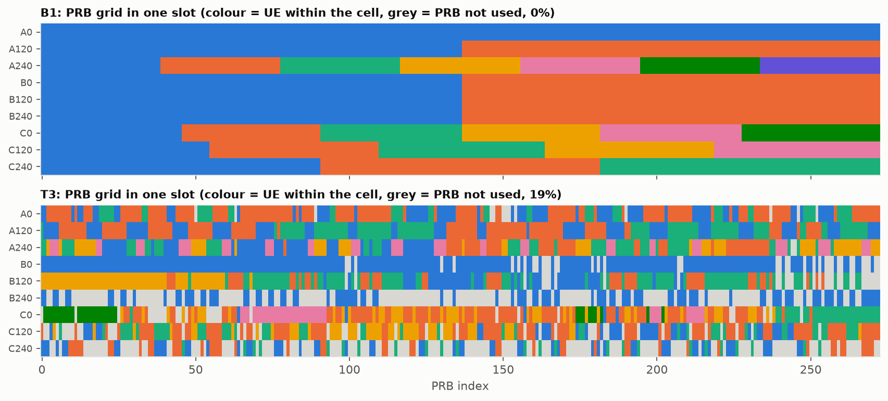

*Fig. 9 — One slot's PRB grid per RU. B1 uses fixed blocks; T3 interleaves UEs by channel
quality and leaves grey PRBs muted where they would hurt a neighbour more than they help.*

### 6.3 How accurate does the twin need to be?

The table above assumes the twin *is* the network. Fig. 16 relaxes that: decisions come from
increasingly imperfect twins and are scored on the physical stand-in.

| Twin used for decisions | Best-server agreement | B1 mean / 5th pct | T3 mean / 5th pct | T3 outage |
|---|---|---|---|---|
| Oracle (= physical network) | 100 % | 38.5 / 0.0 | **75.4 / 16.6** | 0.2 % |
| Twin + measurement sync, GPS positions | 94 % | 37.6 / 0.0 | **50.5 / 6.7** | 0.7 % |
| Twin at true positions, no sync | 74 % | 38.5 / 0.0 | 32.4 / 0.9 | 13.1 % |
| Twin at GPS positions (5 m), no sync | 68 % | 37.6 / 0.0 | 29.5 / 0.2 | 15.6 % |

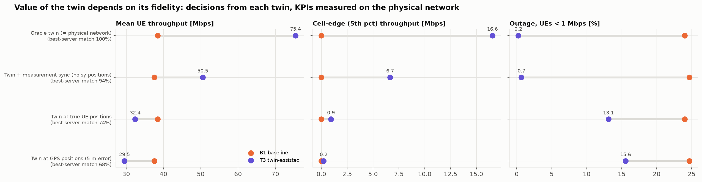

*Fig. 16 — The value of twin-assisted allocation depends on twin fidelity.*

This is the most important result of the project. **An unsynchronised twin can be worse than no
twin for mean throughput**, although it still more than halves outage.

A diagnostic split (in `experiments/e06_twin_fidelity.py`) attributes the loss mainly to two
things. The first is the 5 m position error: in a street canyon, 5 m moves a UE around a corner.
The second is ray-tracing/material mismatch: 27 % of best servers differ. Shadowing and fading
alone cost much less.

**Synchronisation** fixes most of it. Each UE reports SS-RSRP for its 8 strongest cells, as in an
NR measurement report (1 dB resolution, ~2 dB error). The twin keeps its frequency-selective shape
but rescales each reported link to the measured level. This is the "data" element of TR 28.915,
and it is what AODT 1.5's *EM calibration from geo-tagged RSRP traces* automates.

## 7. Mobility and environment changes (Task 5)

Three 130 m walking routes were chosen automatically from the twin's own radio map, picking the
routes with the most best-server changes (Fig. 10). Each was traced every 2 m alongside 29 static
UEs. The twin re-associates the moving UE with an A3-like event: neighbour 3 dB better for two
consecutive steps (≈3 s time-to-trigger at walking speed). The baseline keeps the nearest site.

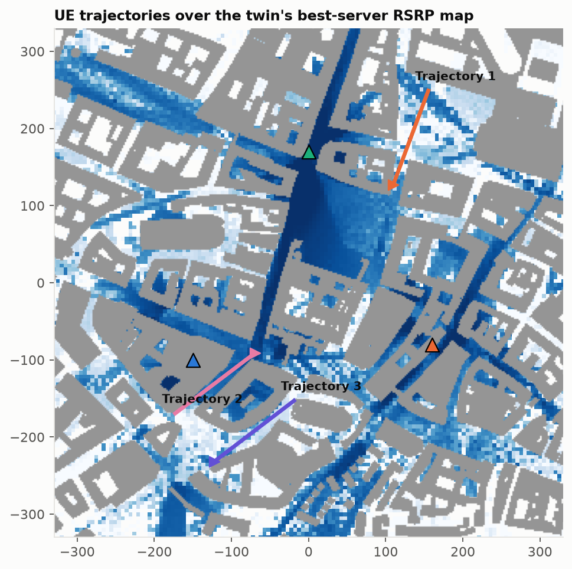

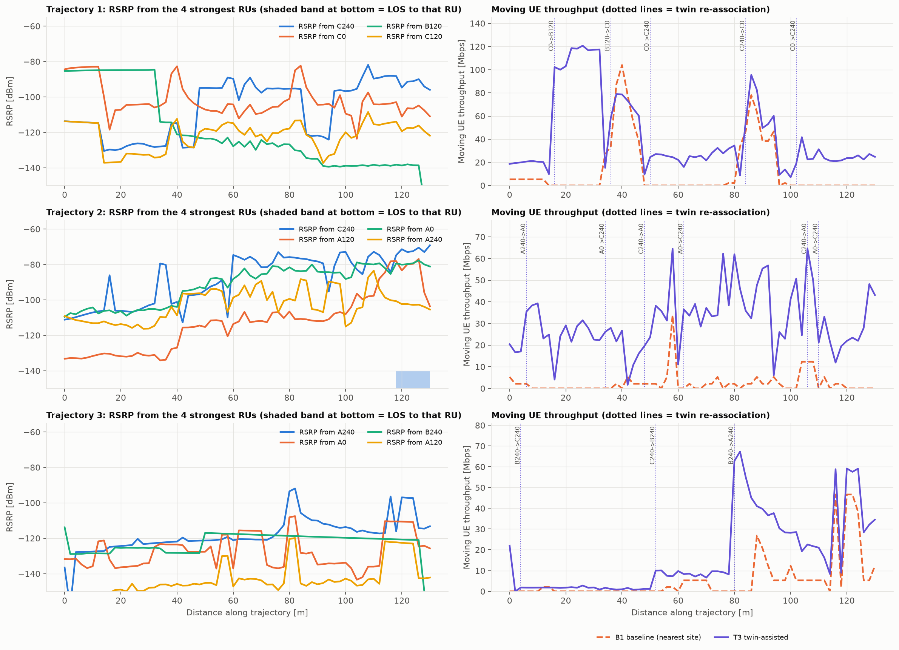

*Fig. 11 — Left: RSRP from the four strongest RUs along each route. Right: the moving UE's
throughput, with dotted lines marking twin re-associations.*

| Route | Mean thr. T3 / B1 [Mbps] | 10th-pct thr. T3 / B1 | Mean SINR T3 / B1 [dB] | Twin handovers |
|---|---|---|---|---|
| 1 | 42.9 / 12.3 | 15.6 / 0.0 | 21.2 / −7.3 | 5 |
| 2 | 30.9 / 2.3 | 16.4 / 0.0 | 19.7 / −7.5 | 6 |
| 3 | 17.1 / 5.4 | 1.2 / 0.0 | 3.2 / −8.5 | 3 |

**Observations**
- Signal levels jump by **20–40 dB within 2–4 m** when the UE crosses a street opening or passes
  a corner (Route 1 at 12 m, 34 m and 48 m). This is the physical-environment effect a distance
  model cannot represent.
- Almost all twin re-associations are NLOS→NLOS with 4–34 dB RSRP gain. In this scene a UE rarely
  has LOS to any site, so the twin chooses between *reflection paths*. That is exactly what ray
  tracing provides and statistics cannot.
- Without time-to-trigger, the twin ping-ponged up to 10 times on a route (first run). Adding a
  2-step TTT reduced that to 3–6 handovers at a small throughput cost (≈7 %). A twin decision layer needs
  the same hysteresis/TTT logic as RRC.
- Route 3 runs through a poorly covered courtyard area. The twin cannot create coverage that does
  not exist, and it is the twin that reveals this gap.

Event table: `results/tables/t5_reassignment_events.csv`.

## 8. What-if analysis (Task 7)

**Procedure.** For each scenario, the operator's twin (synced with measurements, at GPS positions)
decides the association and runs the scheduler. It predicts the KPIs **before** anything is
applied. The same configuration is then "applied" to the physical stand-in and measured.

We also predict the same configuration with two comparators:
- the unsynchronised twin, and
- a non-site-specific **3GPP TR 38.901 UMa** model (LOS-probability-weighted path loss + sector
  pattern) — what a planning tool without a twin would say.

Each scenario uses 10 drops.

| Scenario | Mean thr. predicted (twin+sync) | Actual | Predicted change vs S0 (twin+sync / 38.901) | Actual change |
|---|---|---|---|---|
| S0 Current: 30 UEs, 9 RUs, 100 MHz | 67.4 | 50.6 | — | — |
| S1 UE density ×2 | 33.8 | 24.7 | −49.9 % / −59.0 % | −51.1 % |
| S2 UE density ×3.3 | 21.0 | 14.8 | −68.9 % / −75.8 % | −70.7 % |
| S3 Event hotspot (+40 UEs in 45 m) | 27.5 | 19.4 | −59.2 % / −62.2 % | −61.5 % |
| S4 Carrier 100 → 40 MHz | 26.0 | 19.5 | −61.5 % / −61.0 % | −61.5 % |
| S5 Energy saving: site B off | 38.0 | 28.1 | −43.7 % / −23.5 % | −44.5 % |
| S6 Roll back to baseline scheduler | 43.1 | 41.1 | −36.1 % / +66.0 % | −18.7 % |

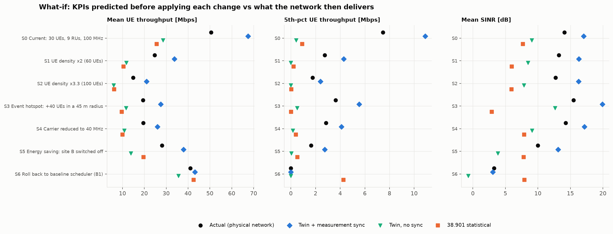

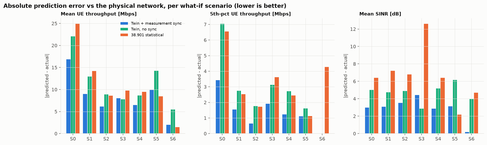

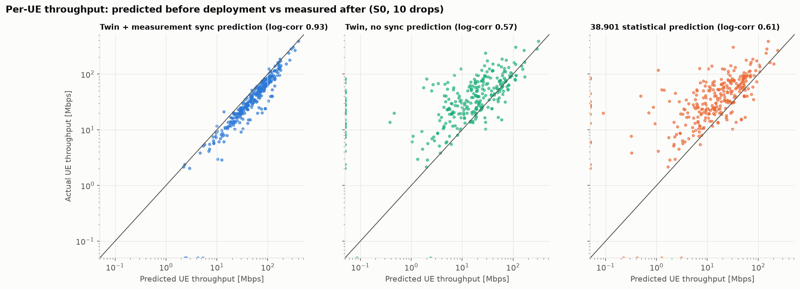

| Prediction accuracy | Twin + sync | Twin, no sync | 38.901 statistical |
|---|---|---|---|
| Error in predicted *change* of mean throughput (mean abs., percentage points) | **3.9** | 11.6 | 20.0 |
| Mean-throughput absolute error [Mbps], avg over scenarios | **8.3** | 11.4 | 11.0 |
| Per-UE throughput correlation (log scale) | **0.93** | 0.57 | 0.61 |
| Outage prediction, S0 (actual 2.3 %) | 1.0 % | 13.3 % | 8.3 % |

**Interpretation**

1. **The synced twin predicts the *effect* of a change very well** (within ~4 points). It is also
   the only predictor that gets *both* decisions right: switching site B off costs ~44 % of mean
   throughput and ~78 % of cell-edge throughput, and rolling back to the baseline scheduler would
   *lose* throughput.

   The 38.901 model underestimates the energy-saving penalty by half (−23.5 % vs −44.5 % actual).
   It also says the rollback would *gain* 66 %. That is wrong in direction, because a statistical
   model cannot see the buildings that make nearest-site association fail. These match TR 28.915
   §5.1 (energy-saving policy verification) and §5.9 (configuration verification).

2. **The absolute level is optimistic by ~30 %** (67 vs 51 Mbps in S0). The twin does not know
   the small-scale fading and unmodelled scatterers of the physical network, so its per-PRB SINR
   is too clean. The bias is consistent across scenarios, which is why *changes* are predicted
   well. A practical twin would learn a correction factor from history; a "same configuration
   today vs tomorrow" comparison cancels it.

3. **Per-UE predictions** (Fig. 14) line up along the diagonal for the synced twin
   (log-correlation 0.93). The other two predictors scatter by an order of magnitude. This
   per-UE accuracy is what enables UE-level decisions such as targeted handover or slice admission.

## 9. The twin as a 5G/6G NDT platform (Task 8)

### 9.1 Capabilities

**Sionna RT (used here)**
- Open source (Apache 2.0), Python, installs with `pip`.
- Scenes from Mitsuba XML, OpenStreetMap via Blender/Geo2SigMap, or built-in scenes.
- Specular reflection, diffuse scattering, refraction, wedge and edge diffraction.
- Custom antenna patterns and arrays, synthetic or real arrays, mobility via Doppler.
- Path-level CIR/CFR and radio maps (coverage, RSS, SINR); the whole ray tracer is differentiable.
- Works with PyTorch/TensorFlow/JAX, enabling gradient-based optimisation of RU positions,
  orientations and materials, plus learned calibration.

**NVIDIA AODT (the brief's suggested platform)**
- Everything above at larger scale (C++/CUDA EM solver), plus a full RAN digital twin: PHY/MAC
  with PDSCH/PUSCH, SRS channel estimation, SRS-based beamforming, 64T64R and MU-MIMO.
- DU–RU association and RU telemetry (throughput, MCS).
- GIS import with procedural indoor generation, UE mobility (from 1.5 also 3D/UAV waypoints).
- AI/ML examples (e.g. AI-based PUSCH channel estimation).
- A results database (raypaths, CIR/CFR, telemetry tables).
- From 1.5: headless/cloud-native operation, a fast EM mode, up to 40 M rays on an L40S,
  EM calibration from measured SS-RSRP traces, and a Python client.

### 9.2 Computational requirements (measured)

Hardware: 2 CPU cores, 8 GB RAM, no GPU (Mitsuba `llvm_ad_mono_polarized` backend). Each
configuration ran in a fresh process; times exclude the 0.2–0.3 s scene load.

| Sweep | Setting | Ray-tracing time | Peak memory |
|---|---|---|---|
| UEs (× 9 RUs, depth 3, 3×10⁵ rays/RU, diffraction) | 25 / 100 / 300 / 600 UEs | 10 / 23 / 68 / 137 s | 0.8 / 0.9 / 1.4 / 1.4 GB |
| Rays per RU (100 UEs) | 10⁵ / 3×10⁵ / 10⁶ | 8 / 22 / 74 s | 0.9 GB |
| Max interactions (100 UEs, no diffraction) | 1 / 2 / 3 / 4 | 8 / 16 / 19 / 23 s | 0.5–0.7 GB |
| Diffraction (100 UEs, depth 3) | off / on | 19 / 23 s | 0.6 / 0.9 GB |
| Radio map, 700 m × 700 m at 5 m, 9 RUs | depth 3 | 14 s | 0.2 GB |

Runtime grows **linearly** with the number of UEs and with the rays launched per RU, and
sub-linearly with path depth. Diffraction adds ~20 %. On this CPU the twin answers "what are the
channels for 100 UEs?" in about 20 s. With a GPU the same code switches to the CUDA backend
automatically; we could not measure that here, so GPU timings are left for the team to add.

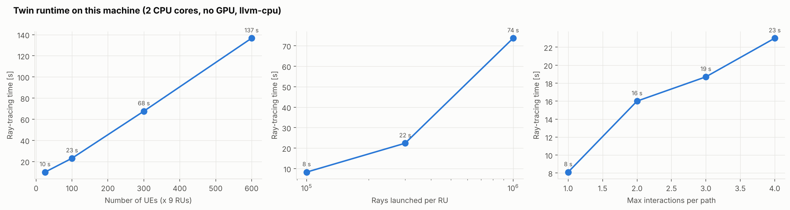

Full project on a 2-core CPU without GPU:
- channel database ≈ 19 min (twin 196 s, twin at GPS positions 191 s, physical 730 s),
- mobility traces ≈ 1 min,
- coverage map 15 s,
- all allocation / mobility / what-if simulation ≈ 15 min.

Peak memory was about 1.3 GB per 200-UE batch. An earlier 850-UE single batch with a 2 M-path
budget ran out of 8 GB, so **batching receivers is required on small machines**.

AODT, by contrast, needs:
- a supported NVIDIA GPU (SM 8.0–9.0, i.e. Ampere, Ada or Hopper; NVIDIA's own figures quote L40S-class cards),
- Ubuntu with Docker/Kubernetes for the backend and a results database,
- an NGC key and 6G Developer Program access.

The cloud installers (AWS/Azure) are the realistic route for a student team.

### 9.3 Limitations observed

1. **Scene fidelity is the ceiling.** OpenStreetMap geometry has no trees, vehicles, street
   furniture or interiors. Material parameters are ITU defaults. Our material change (permittivity ×1.4,
   conductivity ×2) together with deeper tracing moved 19 % of best servers.
2. **Depth-limited tracing misses weak paths.** 45 % of links had no traced path. Interference
   from those links has to be modelled (we used a calibrated 38.901 fill). AODT's higher ray
   counts reduce, but do not remove, this.
3. **Positioning.** Without accurate UE positions, site-specific channels are looked up at the
   wrong place. 5 m error cost more than every propagation effect combined.
4. **No small-scale truth.** A deterministic twin predicts a smooth channel. Fading must be added
   statistically, which causes the ~30 % optimism in §8.
5. **Synchronisation and calibration** need a data pipeline from the live network (measurement
   reports, MDT, RSRP traces). Without it, the twin's value can turn negative (§6.3).
6. **Compute vs freshness.** On CPU a full retrace takes minutes, too slow for per-slot
   decisions. Practical use is slower loops: association and coordination policies (seconds to
   minutes), planning and what-if (hours). GPUs bring retracing to seconds.
7. **Abstraction level of this study.** SISO-equivalent, downlink, full buffer, effective-SINR
   link abstraction. AODT's full PHY/MAC would remove the abstraction for MIMO/beamforming studies.

### 9.4 Research problems this platform is suited for

- **Site-specific RRM:** association, load balancing, CoMP / coordinated scheduling and
  interference management, as here.
- **Beam management** at FR1 massive MIMO and FR2/FR3 (6G upper mid-band 7–24 GHz): beam
  prediction from position, blockage prediction.
- **Mobility robustness:** handover parameter (offset/TTT) tuning per location, conditional
  handover, ping-pong analysis.
- **Energy saving:** cell/carrier switch-off verification (TR 28.915 §5.1), RU sleep scheduling.
- **Network planning and what-if:** RU placement, tilt/azimuth optimisation (Sionna is
  differentiable), new-site evaluation, event planning.
- **Twin calibration:** learning materials and scene corrections from MDT/RSRP traces;
  quantifying the sim-to-real gap (as in §6.3).
- **AI-RAN / ML training data** (TR 28.915 §5.6): site-specific CSI datasets for channel
  estimation, CSI compression, positioning, and O-RAN xApp/rApp testing.
- **6G topics:** RIS placement, ISAC (sensing from multipath), UAV/NTN coverage in 3D, and
  digital-twin-native closed-loop automation.

## 10. Second site: IIT Gandhinagar campus, and a site-placement what-if

To check that the findings are not specific to one city block, we ran the same pipeline on a
very different site: the IIT Gandhinagar (Palaj) campus. It is open, low-rise and spread out,
where Munich is dense and tall. We ran it twice, with two gNB layouts. The comparison is itself
a what-if: *what happens if we move the masts?*

### 10.1 Scene

`tools/build_scene.py` built the scene from OpenStreetMap: a 1.4 km × 1.4 km box centred at
23.2107° N, 72.6872° E. Wikipedia's campus coordinate (23.2114, 72.6821) lies about 520 m west of
the buildings, which left half the box empty and cut off the Sports Complex and Guest House, so
we moved the centre. The box holds 74 buildings covering 4.9 % of the area. Only 28 % of them
have OSM height tags (Academic Blocks 10–12: 24 m; Kyzeel and Lekhaag hostels: 20 m; most other
hostels: 7 m). The rest default to 12 m. Everything else (carrier, power, antennas, 30 UEs per
drop, strategies, physical-network impairments, what-if scenarios) is unchanged from Munich.
The UE pool grows to 1,650 positions and the ray count per source to 4.6× Munich's, because the
area is larger.

### 10.2 Two site layouts

| | Layout 1: rooftop-centre masts | Layout 2: 30 m ground towers |
|---|---|---|
| Site A | Indoor Sports Complex roof, mast 20 m (roof 12 m) | 10 m north of the Sports Complex wall, 30 m |
| Site B | Academic Block 12 roof, mast 28.1 m (roof 24.1 m) | 15 m east of Academic Block 12, 30 m |
| Site C | Kyzeel Hostel roof, mast 24 m (roof 20 m) | 10 m south of Kyzeel Hostel, 30 m |
| Sectors | 0° / 120° / 240° at every site | Rotated per site so the host building lies between two sectors |
| Results | `results/iitgn_rooftop_centre/` | `results/iitgn/` |

Layout 1 used the scene builder's suggestion: a mast at the centre of a tall roof. Site A was moved
by hand from a small housing block to the Sports Complex. The tall academic blocks and hostels all lie
within 100 m of sites B or C, so they could not host it without clustering two sites together.

**Why layout 2.** Layout 1 gave a surprising result: 47 % of users were best served by a site
other than the nearest one, more than in dense Munich (31 %). Checking the geometry showed that
each mast, standing only 4–8 m above the middle of a wide roof, was **shadowed by its own roof
edge**. Within 100 m of the masts, 60 of 65 users (92 %) had no line of sight to their own site,
and in 58 of these cases the blocker was the host roof (Fig. 17). The geometric shadow radius was
about 110–125 m. Raising the masts would not fix this realistically: halving the shadow would need
masts about 11 m taller on B and C, and 54 m in total on the Sports Complex. Layout 2 therefore puts
30 m towers on open ground 10–15 m outside each host building. Each tower stands at the spot (on
a 10–15 m band around the building, at least 10 m from any other building) that has 3-D line
of sight to the most users within 300 m. Its sectors point away from the host wall. Per-site sector
azimuths are an optional `sector_azimuths_deg` entry for each site in the config. Munich is unchanged.

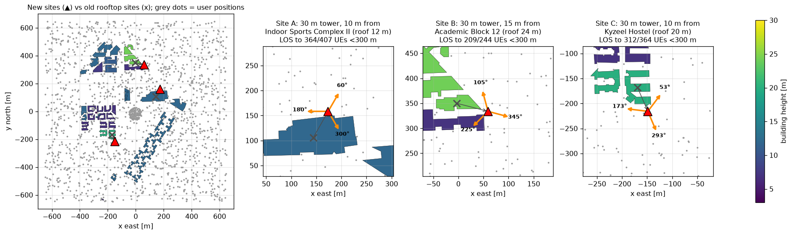

*Layout 2: new towers (▲) vs the old rooftop masts (×), with each tower's sector directions.*

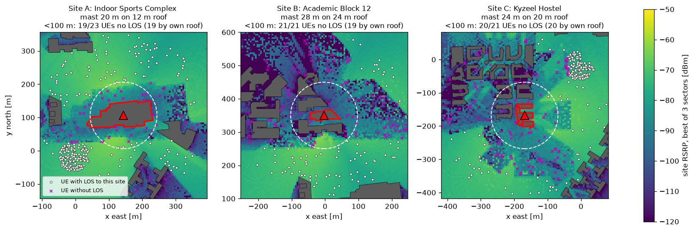

*Fig. 17: Layout 1, best-sector RSRP around each rooftop mast. Inside the dashed 100 m circle,
almost no user (× = no LOS) can see the mast past its own roof edge.*

### 10.3 Results

Values with ± are 95 % confidence intervals over the Monte Carlo drops (§6).

| | IITGN layout 1: rooftop-centre masts | IITGN layout 2: 30 m ground towers | Munich |
|:--|:--|:--|:--|
| Best site is not the nearest [% users] | 47 | 41 | 31 |
| LOS links [%] | 57 | 68 | 5 |
| Users < 100 m from a site with no LOS to it | 60 / 65 (92 %) | 4 / 68 (6 %) | – |
| Median SINR [dB] | 4.4 | 3.9 | 5.9 |
| B1 mean throughput [Mbps] | 19.3 ± 1.7 | 23.3 ± 2.2 | 36.3 ± 2.9 |
| B1 5th-pct throughput [Mbps] | 0.0 | 0.0 | 0.0 |
| B1 outage [%] | 28.7 ± 2.8 | 22.7 ± 2.8 | 26.1 ± 3.2 |
| T3 mean throughput [Mbps] | 55.5 ± 2.3 | 55.3 ± 2.5 | 52.5 ± 3.1 |
| T3 5th-pct throughput [Mbps] | 15.5 ± 1.5 | 15.1 ± 1.4 | 5.7 ± 0.8 |
| T3 outage [%] | 0.1 ± 0.2 | 0.2 ± 0.3 | 1.6 ± 0.9 |
| **T3 gain over B1, mean throughput** | **+188 %** | **+137 %** | **+45 %** |
| What-if: twin per-UE correlation (synchronised) | 0.98 | 0.98 | 0.93 |
| What-if: twin error in predicted change [pp] | 2.8 | 2.8 | 3.9 |
| What-if: TR 38.901 model per-UE correlation | 0.37 | 0.41 | 0.61 |
| What-if: TR 38.901 error in predicted change [pp] | 31.6 | 18.4 | 20.0 |
| Ray-tracing time, CPU (twin + noisy twin + physical) | 47 min | 43 min | 19 min |

**The campus is interference-limited.** With low, scattered buildings, most UEs see their own
site *and* the neighbouring sites (57–68 % LOS links vs 5 % in Munich). Signals are about 18–20 dB
stronger than in Munich (median RSRP −79 / −77 vs −97 dBm), but so is inter-cell interference. Median
SINR is therefore lower than in the city. Distance is a poor guide to the best server, and the
nearest-site baseline B1 suffers from both wrong association and full-reuse interference.

**Twin-assisted allocation reaches the same level regardless of the layout.** T3 achieves about
55 Mbps mean and 15 Mbps at the 5th percentile in both layouts, with essentially no outage. It knows
which site each UE really sees and mutes the PRBs that cause the most interference (about 68 % PRB
utilisation). Cell-edge throughput is almost 3× Munich's, because on an open campus nearly every
location has *some* clear path to a site.

**Moving the masts helps the baseline, not the twin.** The towers removed the rooftop shadow
(no-LOS users near a site: 92 % → 6 %). The share of users for whom the nearest site is wrong
fell from 47 % to 41 %. B1 gained about 4 Mbps mean and about 6 points of outage; both changes
sit at the edge of the confidence intervals. T3 did not change. The apparent twin gain therefore
fell from +188 % to +137 %: part of the layout-1 gain was the twin compensating for a poor
mast placement. That is useful in itself, because a twin that exposes such a placement error is
worth having before deployment. But it means **the twin's gain should be quoted against a sensibly
planned baseline**. The remaining 41 % is genuine. 57–58 % of the UEs are more than 300 m from every site (the
box is mostly open land around a compact campus). There, two sites are often almost equally
far away, and the antenna pattern or a single building decides which one is stronger.

**What-if prediction.** The synchronised twin predicts the six what-if scenarios equally well in
both layouts (2.8 pp mean error), and better than in Munich. The TR 38.901 model, built for
typical urban streets, fits the open campus poorly (per-UE correlation 0.37–0.41). Its
error in the predicted change varies a lot between the two runs (31.6 vs 18.4 pp). That suggests
its accuracy depends strongly on the particular UE drop, not just the site.

### 10.4 Caveats specific to IITGN

1. **No vegetation.** The campus is heavily wooded, but the scene has no trees. Real foliage
   would block some of the LOS links, reducing interference, improving B1 and shrinking the twin gain.
   The IITGN gains are best read as an upper bound for this site.
2. **Building heights are mostly assumed.** 72 % of the buildings, including the Sports Complex,
   use the 12 m default. Several kiosks under 30 m² become 12 m blocks.
3. **The two layouts use different random UE pools.** The cached positions were deliberately cleared
   before the layout-2 run, so the comparison includes drop-to-drop randomness. The mobility walks
   (Task 5) were also redrawn, so their handover counts are not compared between layouts.
4. **Site placement is a heuristic** (most users in 3-D LOS within 300 m), not an optimisation.
   In layout 2, sites A and B ended up only 210 m apart. A proper placement study, for example
   with Sionna's differentiable ray tracing (§9.4), is future work.

## 11. Conclusions

- A ray-traced twin shows that in dense urban deployments, geometry-based allocation fails for
  roughly a third of locations. Twin-assisted association, scheduling and interference
  coordination raise mean throughput by 45 %, lift cell-edge throughput from zero to 5.7 Mbps,
  and remove almost all outage.
- These gains hold on a different physical network **only if the twin is synchronised with
  network measurements**. An unsynchronised twin is not a safe basis for decisions.
- With synchronisation, the twin predicts the effect of what-if changes within about 4
  percentage points and gets the operational decisions right, where a standard statistical model
  gets the direction wrong.

**Future work**
- Run the same pipeline on AODT with MIMO/beamforming.
- Learn the fading/optimism correction from data.
- Close the loop with real MDT traces or an OpenAirInterface/Sionna Research Kit testbed.

## Reproducing

```bash
pip install -r requirements.txt
python run_all.py            # everything (≈ 45–60 min on 2 CPU cores; faster on a GPU)

# IIT Gandhinagar campus (§10), layout 2; results in results/iitgn/ (≈ 45 min on an Apple-silicon Mac CPU)
DT_CONFIG=config/iitgn.yaml python run_all.py --skip-bench
DT_CONFIG=config/iitgn.yaml python tools/export_3d.py    # interactive 3D view: results/iitgn/twin_3d.html
```

Layout 1 (rooftop-centre masts) results and the config that produced them are kept in
`results/iitgn_rooftop_centre/` (`iitgn_config_used.yaml`).

| Deliverable | Location |
|---|---|
| Scenario & parameter table | Fig. 1, `t1_parameters.csv` |
| Channel database & RAN measurements | `t2_*.csv`, `data/*.npz`, Figs 2–5 |
| Baseline & channel-aware allocation | `dt/alloc.py`, Figs 6, 9 |
| Mobility | Figs 10–11, `t5_*.csv` |
| KPI comparison | Figs 7–8, 16, `t6_*.csv` |
| What-if | Figs 12–14, `t7_*.csv` |
| Platform evaluation | §9, Fig. 15, `t8_*.csv` |

## References

1. 3GPP TR 28.915 V19.0.0, *Study on management aspects of Network Digital Twin*, 2025.
2. Hoydis et al., *Sionna RT: Technical Report*, arXiv:2504.21719, 2025.
3. NVIDIA, *Aerial Omniverse Digital Twin documentation* (installation, release notes 1.1–1.5).
4. *Better Together: Leveraging Multiple Digital Twins for Deployment Optimization of Airborne
   Base Stations* (Sionna RT and AODT comparison), arXiv:2508.15816, 2025.
5. 3GPP TR 38.901 (channel model), TS 38.214 (CQI tables), TS 38.306 (peak-rate formula),
   TS 38.101-1 (PRB counts).
